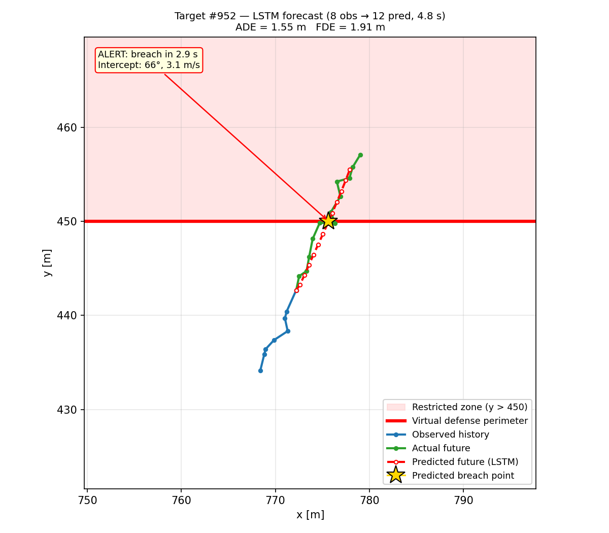
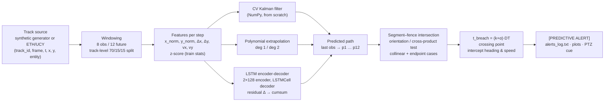
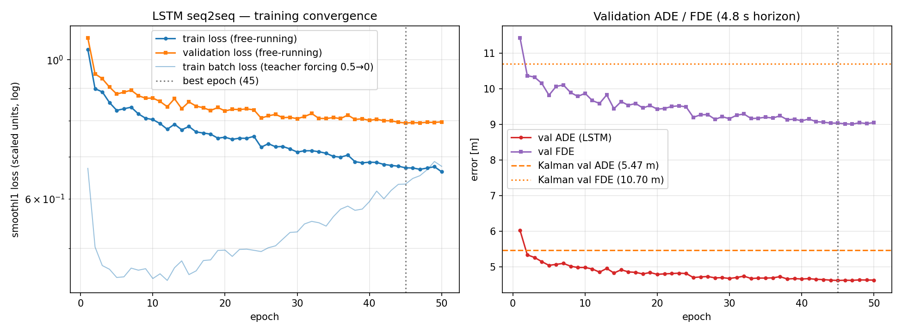
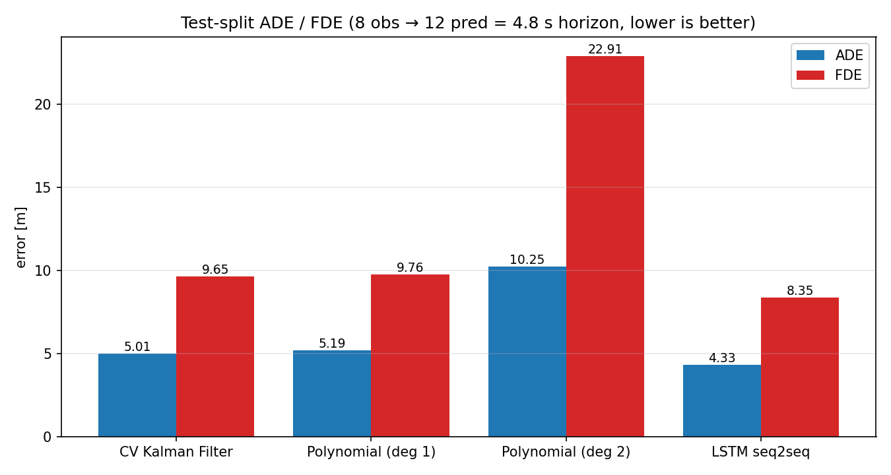
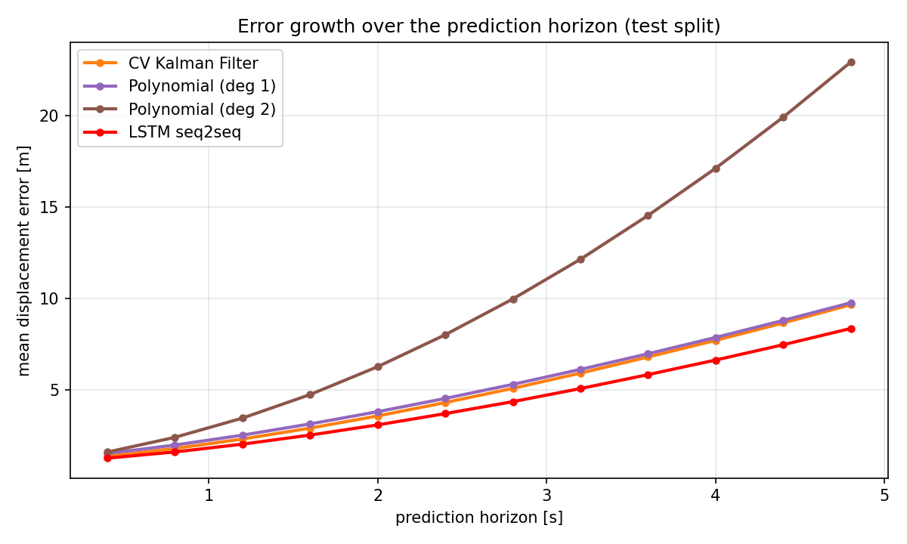
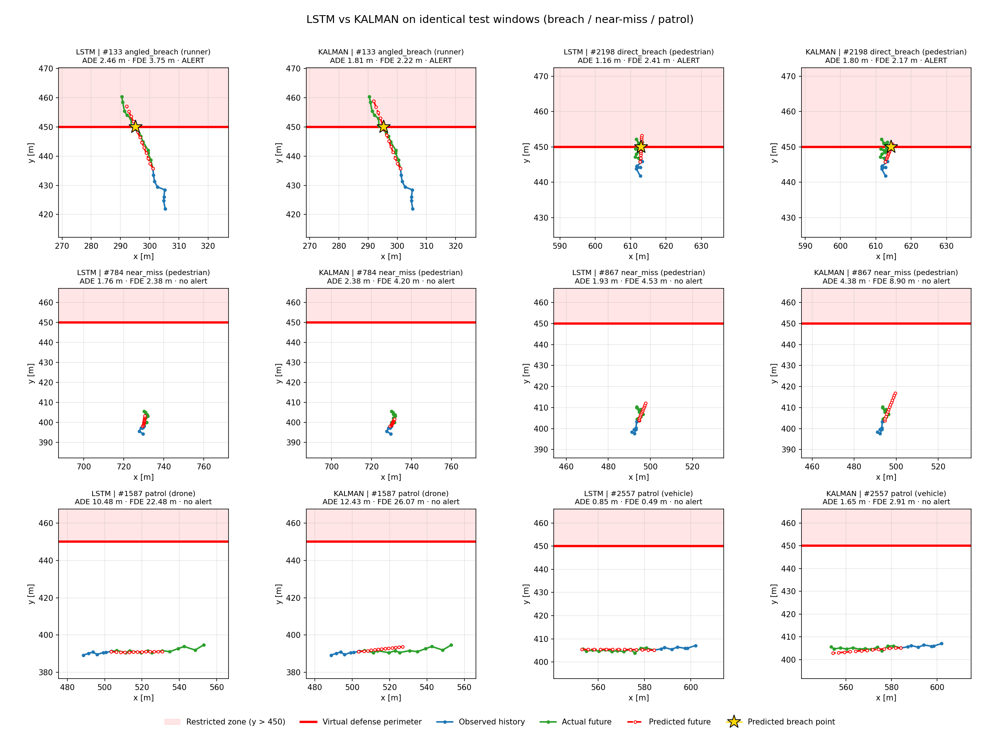
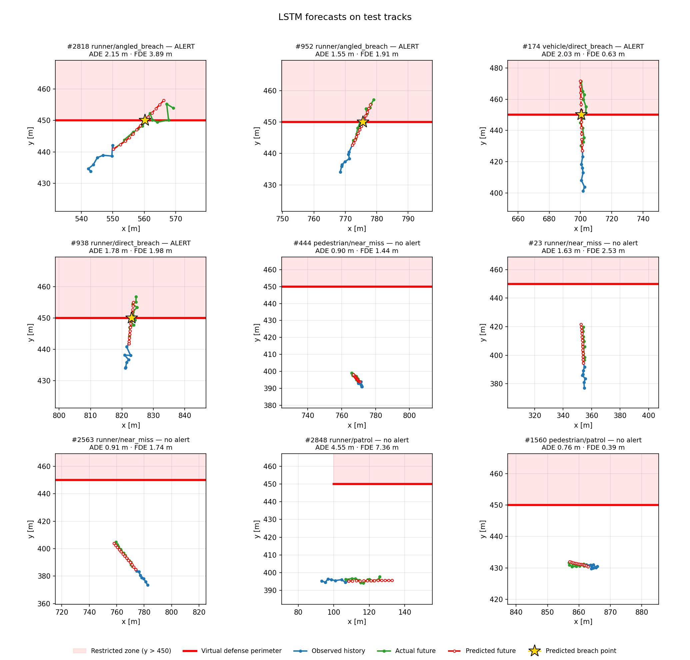

# Netra-One · Target Trajectory Forecasting & Predictive Perimeter-Breach Alerts

**0xAstra 24-hour technical challenge: Netra-One Tactical Defense AI.**

[](https://colab.research.google.com/github/kvlokesh2005-arch/bogathi-netraone-trajectory-prediction/blob/main/notebooks/netraone_colab.ipynb)

Netra-One watches high-security perimeters such as air-force bases and borders. This repository contains a
**trajectory forecasting model** that reads the last 3.2 s of an intruder's (x, y) track, predicts the next 4.8 s,
and raises a **predictive perimeter-breach alert** *before* the intruder physically crosses the fence. Each alert includes
time-to-breach, crossing point and an **intercept vector** (heading and speed) for PTZ cameras and responders:

```
[PREDICTIVE ALERT] Target ID #104 trajectory intersects Restricted Fence in 2.4 seconds! Intercept Vector: [Angle 42°, Velocity 3.8 m/s]
```

### Headline results (held-out test tracks, 4.8 s horizon)

| | CV Kalman | Polynomial deg 1 | **LSTM seq2seq** |
|---|---|---|---|
| ADE [m] | 5.007 | 5.194 | **4.329** (−13.5 % vs Kalman) |
| FDE [m] | 9.650 | 9.759 | **8.355** (−13.4 %) |
| Alert F1 (per window) | 0.875 | — | **0.903** |
| False-positive alert windows | 294 | — | **210** (−29 %) |
| Breach tracks caught before crossing | 181 / 182 | — | **181 / 182** |
| Mean alert lead time | 4.88 s | — | 4.56 s |

Training takes **7.6 min on a laptop CPU** (50 epochs). The trained weights are committed, and `pytest -q` passes all 35 tests.



---

## Contents
1. [Problem statement](#1-problem-statement)
2. [Approach & architecture](#2-approach--architecture)
3. [Dataset & generator](#3-dataset-synthetic-generator)
4. [Models](#4-models)
5. [Reproduce](#5-reproduce)
6. [Results: ADE / FDE](#6-results-adefde-test-split)
7. [Predictive breach alerts](#7-predictive-breach-alerts)
8. [Visualisations](#8-visualisations)
9. [Analysis: when does the LSTM beat Kalman?](#9-analysis-when-does-the-lstm-beat-kalman)
10. [Limitations & assumptions](#10-limitations--assumptions)
11. [Future work](#11-future-work)
12. [Repository layout](#12-repository-layout)

---

## 1. Problem statement
Given a target's observed history of `T_OBS = 8` frames (3.2 s at 2.5 Hz, the ETH/UCY frame rate), the system must:

* **forecast** the next `T_PRED = 12` waypoints (4.8 s horizon);
* **benchmark** a deep sequence model against classical baselines with ADE/FDE;
* **detect** whether the predicted path intersects the virtual perimeter
  `FENCE_LINE = [(100, 450), (900, 450)]` (restricted zone y > 450, units in metres), and if it does,
  **alert early** with the time-to-breach and the intercept vector.

## 2. Approach & architecture



Design choices:

* **Translation-invariant target.** The network predicts the future *relative to the last observed point*.
  Absolute world position enters only as a normalised input feature, so the model can still learn fence-relative
  behaviour such as turning away near the perimeter.
* **Residual constant-velocity prior.** At each decoder step the network outputs a *correction* to the previous
  per-step displacement. With a zero correction the LSTM reduces to constant velocity, so it only has to learn deviations:
  turns, decelerations, retreats.
* **One predictor interface.** Every model implements `predict(obs_xy[B,8,2]) -> [B,12,2]` in world metres,
  so the evaluation, alerting and plotting code is model-agnostic (`models/trajectory_model.py`).

## 3. Dataset: synthetic generator
`generate_synthetic_tracks.py` generates realistic intruder tracks with a **constant-turn-rate + acceleration (CTRA)**
kinematic model. The state is `(x, y, heading, speed)`. A proportional steering controller pulls the heading
toward a behaviour-specific goal under a bounded turn rate. Process noise acts on turn rate and acceleration,
rogue drones make abrupt heading jolts and speed changes, and Gaussian **sensor noise** (σ ~ U(0.3, 1.0) m per track)
is added to every measurement.

| Entity | Speed [m/s] | Motion character |
|---|---|---|
| pedestrian | 1.0 – 2.0 | smooth random heading changes |
| runner / intruder | 3.0 – 6.0 | agile, moderate turn rate |
| vehicle | 5 – 15 | gentle turns (max 0.25 rad/s → bounded curvature) |
| rogue drone | 4 – 20 | sudden heading jolts (6 %/frame) and accelerations |

| Behaviour | Ground truth | Purpose |
|---|---|---|
| direct approach | **breach** | nearly perpendicular run at the fence |
| angled approach | **breach** | 20–55° oblique approach |
| patrol | no breach | moves parallel to the fence, 10–60 m outside |
| near miss | no breach | approaches, then turns away 15–60 m (≥ 1.3 turn radii) before the fence: **tests false alarms** |
| wander | no breach | random walk in the far field (y < 300) |

Every track starts outside the restricted zone. Tracks run 40–80 frames and are rejection-sampled, so breach tracks
really cross (after at least 8 clean frames) and non-breach tracks never do.

Generated dataset (`python generate_synthetic_tracks.py --num-tracks 3000`, seed 42, byte-identical on re-run;
full log in [`sample_outputs/dataset_summary.txt`](sample_outputs/dataset_summary.txt)):

| Statistic | Value |
|---|---|
| Tracks / rows | 3 000 tracks, 178 324 observations (mean 59.4 frames, 23.8 s) |
| Entities | vehicle 765 · pedestrian 755 · drone 742 · runner 738 |
| Behaviours | direct breach 628 · wander 623 · near miss 603 · angled breach 583 · patrol 563 |
| Tracks that cross the fence | 1 211 (40.4 %) |
| Measured speed (with sensor noise) | drone 12.5 · vehicle 10.3 · runner 5.2 · pedestrian 3.2 m/s (noise inflates slow targets) |
| Windows (stride 1) | train 85 356 · val 9 074 (stride 2) · test 18 035 |
| Track split | train 2 100 · val 448 · test 452 (by `track_id`, stratified by behaviour) |

**Real data:** `load_ethucy()` ingests the ETH/UCY `frame ped_id x y` text format into the same schema
(frames re-indexed to 2.5 Hz, gapped tracks split), so the whole pipeline can run on real pedestrians:
`python generate_synthetic_tracks.py --source ethucy --path datasets/eth/biwi_eth.txt`.

**Features** (`dataset_loader.py`), per observed step:
`[x_norm, y_norm, Δx, Δy, vx, vy]`, with world-bounds normalisation to [0, 1], frame-to-frame displacement and
velocity = Δ/DT. They're z-scored with **train-split statistics only**, which are saved to `checkpoints/norm_stats.json`.
The split is by `track_id` (70/15/15, stratified by behaviour), and `tests/test_dataset.py` asserts that no track leaks.

## 4. Models

| Model | Implementation |
|---|---|
| **CV Kalman filter** | `models/kalman_baseline.py`. State `[x, y, vx, vy]`; `F` = CV transition, `H` = position observation, `Q` = white-noise-acceleration (σₐ = 1.5 m/s²), `R` = σ² I (σ = 0.7 m). Initialised from the first two observations, filtered over the rest, then 12 predict steps. The noise parameters were grid-searched on the **validation** split (the ADE surface is flat to within 0.01 m). |
| **Polynomial** | Least-squares fit of x(t), y(t) over the 8 observations, degree 1 and degree 2, extrapolated. |
| **LSTM seq2seq** | `models/seq2seq_predictor.py`. Linear+ReLU input projection → **2-layer LSTM encoder (hidden 128, dropout 0.1)** → **autoregressive LSTMCell decoder** seeded with the encoder's top-layer (h, c). Each step embeds the previous displacement, and an MLP head predicts a residual Δ; `cumsum` gives positions. Pass `--cell gru` for the GRU variant. 323 k parameters. |

**Training** (`train.py`): Adam (lr 1e-3), ReduceLROnPlateau (×0.5, patience 3) on val ADE, gradient clipping at 1.0,
**Smooth-L1** loss (`--loss mse` available) on scaled relative positions, teacher forcing decayed linearly **0.5 → 0**,
early stopping (patience 10) on **validation ADE**, and the best checkpoint saved to `checkpoints/best_model.pt`.
To fit the CPU budget, each epoch draws a fresh random subset of 32 768 of the 85 k stride-1 training windows
(`--samples-per-epoch 0` uses all of them). CUDA is used automatically when available (Colab T4). All seeds are fixed (42).

Training run (`python train.py --cell lstm --epochs 50`, CPU, full log in
[`sample_outputs/train_log_lstm.txt`](sample_outputs/train_log_lstm.txt)):

| Epoch | Train loss (free-running) | Val loss | Val ADE [m] | Val FDE [m] | LR | TF ratio |
|---|---|---|---|---|---|---|
| 1 | 1.039 | 1.084 | 6.015 | 11.420 | 1e-3 | 0.50 |
| 10 | 0.803 | 0.869 | 4.977 | 9.866 | 1e-3 | 0.41 |
| 20 | 0.753 | 0.829 | 4.784 | 9.423 | 1e-3 | 0.31 |
| 30 | 0.713 | 0.806 | 4.670 | 9.154 | 5e-4 | 0.20 |
| **45 (best)** | 0.673 | 0.793 | **4.614** | **9.030** | 2.5e-4 | 0.05 |
| 50 | 0.663 | 0.796 | 4.624 | 9.044 | 1.3e-4 | 0.00 |

Wall time is 7.6 min (about 9 s per epoch on an 8-thread laptop CPU). For reference, the Kalman filter scores
5.468 m ADE / 10.698 m FDE on validation. The LSTM passes it at epoch 2 and keeps improving until the LR schedule and
teacher-forcing decay flatten the curve.
In the left panel, the faint *teacher-forced* batch loss rises as teacher forcing is withdrawn (the task gets harder).
The **free-running** train and validation losses, which use the same metric, fall steadily, and the train/val gap
stays small (no over-fitting).



## 5. Reproduce

Windows (PowerShell):
```bash
git clone https://github.com/kvlokesh2005-arch/bogathi-netraone-trajectory-prediction.git
cd bogathi-netraone-trajectory-prediction
python -m venv .venv
.venv\Scripts\activate
pip install -r requirements.txt
python generate_synthetic_tracks.py --num-tracks 3000
python train.py --cell lstm --epochs 50
python evaluate.py
python predict_breach.py --model lstm --num-samples 9
python predict_breach.py --model kalman --track-id 104
python predict_breach.py --model lstm --demo
pytest -q
```
On Linux/macOS, activate with `source .venv/bin/activate`. **Google Colab:** open `notebooks/netraone_colab.ipynb`
(badge at the top), which runs the same commands. `requirements.txt` uses lower bounds so Colab keeps its CUDA
build of torch; the exact versions used for the numbers below are in `requirements-lock.txt`
(Python 3.10.11, torch 2.14.0 CPU, Windows 11 laptop).

The trained weights are committed (`checkpoints/best_model.pt`, ≈1.3 MB, plus `norm_stats.json`), so you can skip `train.py`.
`evaluate.py` and `predict_breach.py` only need the dataset, which the generator recreates deterministically from seed 42.

## 6. Results: ADE/FDE (test split)
ADE is the mean Euclidean error over all 12 predicted steps. FDE is the error at the final step (t + 4.8 s).
Both are in **metres**, on **held-out test tracks** (tracks never seen in training or validation), with every stride-1 window.

### Overall (test split: 452 tracks, 18035 windows, 8 obs → 12 pred = 4.8 s)

| Model | ADE [m] | FDE [m] | Inference [ms/traj, batched] | Inference [ms/traj, single] |
|---|---|---|---|---|
| CV Kalman Filter | 5.007 | 9.650 | 0.0064 | 0.259 |
| Polynomial (deg 1) | 5.194 | 9.759 | 0.0005 | 0.043 |
| Polynomial (deg 2) | 10.253 | 22.908 | 0.0005 | 0.038 |
| **LSTM seq2seq** | **4.329** | **8.355** | 0.0496 | 2.970 |

### By entity type (ADE / FDE in metres, best in bold)

| entity | N | CV Kalman Filter ADE / FDE | Polynomial (deg 1) ADE / FDE | Polynomial (deg 2) ADE / FDE | LSTM seq2seq ADE / FDE |
|---|---|---|---|---|---|
| drone | 4230 | 10.23 / 20.67 | 11.52 / 22.37 | 17.87 / 40.81 | **9.12 / 18.73** |
| pedestrian | 4961 | 2.35 / 3.84 | 1.95 / 3.06 | 7.06 / 15.28 | **1.84 / 2.83** |
| runner | 4294 | 3.57 / 6.56 | 3.45 / 6.24 | 8.49 / 18.66 | **3.13 / 5.67** |
| vehicle | 4550 | 4.40 / 8.66 | 4.49 / 8.67 | 8.31 / 18.59 | **3.72 / 7.27** |

### By behaviour (ADE / FDE in metres, best in bold)

| behavior | N | CV Kalman Filter ADE / FDE | Polynomial (deg 1) ADE / FDE | Polynomial (deg 2) ADE / FDE | LSTM seq2seq ADE / FDE |
|---|---|---|---|---|---|
| angled_breach | 3569 | 3.12 / 5.32 | 2.88 / 4.75 | 8.39 / 18.31 | **2.86 / 4.84** |
| direct_breach | 3698 | 3.03 / 5.12 | 2.69 / 4.38 | 8.39 / 18.26 | **2.66 / 4.38** |
| near_miss | 3456 | 6.46 / 13.26 | 7.00 / 14.07 | 11.67 / 26.46 | **5.45 / 11.26** |
| patrol | 3521 | 2.97 / 4.93 | 2.66 / 4.25 | 8.32 / 18.06 | **2.42 / 3.81** |
| wander | 3791 | 9.28 / 19.24 | 10.53 / 20.92 | 14.34 / 33.03 | **8.09 / 17.11** |




## 7. Predictive breach alerts
`predict_breach.py` implements the early-warning logic from scratch:

1. **Gate:** only targets whose whole observed history lies outside the restricted zone, and never crossed, are evaluated.
2. **Path:** the predicted path `[last_obs → p1 → … → p12]` is treated as 12 segments.
3. **Intersection:** each segment is tested against each fence segment with the **orientation (cross-product) test**, including
   collinear-overlap and touching-endpoint cases. The fence can be any polyline or closed polygon (`fence_segments(points, closed)`).
4. **Timing:** at the first hit, the parametric fraction α along segment *k* gives the exact crossing point and
   `t_breach = (k + α) · DT`.
5. **Intercept vector:** the heading is `atan2(Δy, Δx)` of the crossing segment in degrees from the +x axis (0–360),
   and the speed is `|segment| / DT` in m/s.
6. The alert is printed in the exact required format, followed by the crossing point, and appended to `sample_outputs/alerts_log.txt`.

Sample output (`python predict_breach.py --model lstm --num-samples 9`):
```
[PREDICTIVE ALERT] Target ID #2818 trajectory intersects Restricted Fence in 2.9 seconds! Intercept Vector: [Angle 47°, Velocity 4.6 m/s]
    -> predicted crossing point (x, y) = (560.2 m, 450.0 m)
[PREDICTIVE ALERT] Target ID #952 trajectory intersects Restricted Fence in 2.9 seconds! Intercept Vector: [Angle 66°, Velocity 3.1 m/s]
    -> predicted crossing point (x, y) = (775.7 m, 450.0 m)
[PREDICTIVE ALERT] Target ID #174 trajectory intersects Restricted Fence in 2.5 seconds! Intercept Vector: [Angle 91°, Velocity 9.4 m/s]
    -> predicted crossing point (x, y) = (700.5 m, 450.0 m)
[PREDICTIVE ALERT] Target ID #938 trajectory intersects Restricted Fence in 3.0 seconds! Intercept Vector: [Angle 83°, Velocity 2.8 m/s]
    -> predicted crossing point (x, y) = (823.1 m, 450.0 m)

# python predict_breach.py --model kalman --track-id 104
[PREDICTIVE ALERT] Target ID #104 trajectory intersects Restricted Fence in 2.5 seconds! Intercept Vector: [Angle 47°, Velocity 18.6 m/s]
    -> predicted crossing point (x, y) = (193.5 m, 450.0 m)

# python predict_breach.py --model lstm --demo   (live, frame by frame)
=== LIVE DEMO: target #296 (direct_breach), model=lstm, actual crossing at t=9.2 s ===
t=  2.8s  pos=( 647.0, 390.7)  clear
t=  3.2s  pos=( 644.0, 395.1)  clear
t=  3.6s  pos=( 646.3, 399.1)  clear
t=  4.0s  pos=( 646.1, 401.5)  clear
t=  4.4s  pos=( 646.9, 406.3)  clear
t=  4.8s  [PREDICTIVE ALERT] Target ID #296 trajectory intersects Restricted Fence in 4.4 seconds! Intercept Vector: [Angle 91°, Velocity 9.4 m/s]
...
t=  8.8s  [PREDICTIVE ALERT] Target ID #296 trajectory intersects Restricted Fence in 0.4 seconds! Intercept Vector: [Angle 85°, Velocity 9.5 m/s]
    -> predicted crossing point (x, y) = (647.8 m, 450.0 m)
t=  9.2s  pos=( 648.4, 450.0)  TARGET INSIDE RESTRICTED ZONE — tracking only
=== first alert at t=4.8s, actual crossing at t=9.2s -> lead time 4.4s ===
```

### Alert quality on the test split (Kalman vs LSTM)
Every test track is **streamed frame by frame**, as in deployment. Two levels are scored:

* **Window level:** every 8-frame history outside the zone. The label is "the ground-truth next 4.8 s crosses the fence",
  and the prediction is "the forecast path crosses the fence".
* **Track level:** the first alert per track. An alert on a breach track *before* the real crossing is a TP, and
  lead time = t_actual_crossing − t_first_alert. Any alert on a non-breach track (patrol, near miss, wander) is a **false alarm**.

| Model | Level | Precision | Recall | F1 | False-alarm rate | TP | FP | FN | TN |
|---|---|---|---|---|---|---|---|---|---|
| KALMAN | window | 0.852 | 0.900 | 0.875 | 0.021 | 1693 | 294 | 188 | 13502 |
| KALMAN | track | 0.900 | 0.995 | 0.945 | 0.074 | 181 | 20 | 1 | 250 |
| LSTM | window | 0.891 | 0.915 | 0.903 | 0.015 | 1721 | 210 | 160 | 13586 |
| LSTM | track | 0.914 | 0.995 | 0.953 | 0.063 | 181 | 17 | 1 | 253 |

| Model | Mean lead time [s] | Median lead time [s] | Windows | Tracks |
|---|---|---|---|---|
| KALMAN | 4.88 | 4.72 | 15677 | 452 |
| LSTM | 4.56 | 4.40 | 15677 | 452 |

Test split: 452 tracks (182 breach, 270 non-breach), 15 677 evaluable windows.

* **Both models catch 181 of the 182 breaching tracks** before the physical crossing, on average about **4.6–4.9 s early**.
* **The LSTM cuts false-positive windows by 29 %** (294 → 210) and raises window-level precision from 0.852 to 0.891 while
  *also* raising recall (0.900 → 0.915), for F1 0.875 → 0.903. The track-level false-alarm rate drops from 7.4 % to 6.3 %.
* **Where false alarms come from:** all 17 LSTM false-alarm tracks are *near-miss* approaches (14 drones, 3 runners).
  The Kalman filter's 20 are 19 near-misses plus 1 patrol. A near-miss target is, by construction, heading straight
  at the fence until it turns away 15–60 m out, so any predictor that sees only its history *should* warn. These are
  operationally reasonable "probe" alerts, not noise.
* **Lead time trade-off:** the Kalman filter alerts about 0.3 s earlier on average because pure straight-line
  extrapolation reaches the fence sooner. That same over-extrapolation is what produces its extra false alarms.
  (Lead times can exceed the 4.8 s horizon when a target slows down after the alert.)

## 8. Visualisations
All figures are in `sample_outputs/`. Styles: **blue** = observed history, **green** = actual future,
**red dashed** = predicted future, **red solid** = virtual perimeter, shaded = restricted zone, ★ = predicted breach point.

**LSTM vs Kalman on identical test windows** (breach / near-miss / patrol, with the LSTM in the left panel of each pair):


**LSTM forecasts on 9 test tracks:**


## 9. Analysis: when does the LSTM beat Kalman?
**Where the LSTM wins (per-behaviour and per-entity tables in §6):**

* **Manoeuvres and turn-aways:** on *near-miss* tracks, which approach and then turn away, the LSTM cuts ADE by
  **16 %** (6.46 → 5.45 m) and FDE by 15 % versus Kalman. Because position is an input feature, it learns that
  targets close to the fence tend to slow and turn, which a constant-velocity model can't represent.
  The comparison grid shows this directly: on near-miss #867 the Kalman forecast overshoots toward the fence
  (FDE 8.9 m), while the LSTM bends with the target (FDE 4.5 m).
* **Curvature and speed changes:** vehicles (bounded-curvature turns) improve by 15.5 % ADE, and patrols by 18.5 %
  (the LSTM learns the patrol line's weave). Drones improve by 11 % despite their random jolts.
* **Noise-robust velocity:** on slow pedestrians, where σ ≈ 1 m sensor noise is comparable to the 0.4–0.8 m
  per-frame motion, the Kalman filter chases the noise (2.35 m ADE). Least-squares poly1 smooths better (1.95 m), and
  the LSTM is best (1.84 m), because it learns a noise-averaging velocity estimator over all 8 steps.
* **Error growth:** `error_vs_step.png` shows that the gap widens with the horizon. The models are nearly tied at
  t+0.4 s, and the LSTM is about 1.3 m better than Kalman at t+4.8 s, where manoeuvres dominate.

**Where it doesn't win, or doesn't matter:**

* **Straight constant-velocity approaches:** on *direct breaches* the LSTM (2.66 / 4.38 m) only ties polynomial
  deg 1 (2.69 / 4.38 m). On *angled breaches* poly1 even has a slightly better FDE (4.75 vs 4.84 m).
  When the physics really is constant velocity, a two-parameter fit is already near-optimal, and the network adds
  latency and model risk for no gain.
* **Unpredictable events:** a drone's random heading jolt or a near-miss turn-away that happens *after* the observed
  window can't be forecast from history by any model. That's why drones and wanderers keep 8–10 m ADE for all models,
  and why the remaining false alarms are near-miss drones. It calls for multimodal forecasts (see future work),
  not a bigger deterministic model.
* **Latency:** the Kalman filter needs 0.26 ms per single trajectory, versus about 3 ms for the LSTM on CPU
  (0.05 ms/trajectory batched). Both are far inside the 400 ms frame budget, but the Kalman filter needs no training
  data and degrades gracefully out of distribution.
* **Polynomial deg 2** is the worst model (10.3 m ADE): fitting curvature to 8 noisy points and extrapolating
  12 steps amplifies noise quadratically. It's a useful negative control.

**Takeaway:** use the LSTM as the primary forecaster, because it's more accurate *and* raises fewer false alarms,
and keep the Kalman filter as an always-on, training-free fallback and sanity check.

## 10. Limitations & assumptions
* **Synthetic data.** All numbers come from the synthetic generator. Real intruders (ETH/UCY pedestrians, radar
  tracks) behave differently, so the absolute ADE/FDE values aren't comparable with ETH/UCY leaderboards.
  The ETH/UCY loader is provided but wasn't benchmarked here.
* **Deterministic single-hypothesis forecasts.** One predicted path gives a hard yes/no alert with no probability.
  Near-miss probes are therefore alerted, which is arguably desirable, but not calibrated.
* **The model sees absolute position,** so it partly learns *this* fence's geometry. A new perimeter layout would need
  fence-relative features (signed distance and bearing to the nearest fence segment) or retraining.
* **2-D only:** drone altitude, occlusions and track fragmentation (ID switches) are not modelled.
* **CPU budget:** each epoch samples 32 768 of the 85 k training windows so that 50 epochs fit in about 8 min.
  Training on all windows (`--samples-per-epoch 0`) or on a GPU would likely gain a little more.

**Assumptions made**

1. The restricted zone is the polygon above the fence *between its posts* (x ∈ [100, 900], y > 450). Crossing
   y = 450 outside the posts is not a breach. The breach test itself is segment-vs-fence, so it generalises to any
   polyline or polygon.
2. A `behavior` column was added to the specified CSV schema (`track_id, frame, timestamp, x, y, entity_type`).
   It's used only for stratified splitting and analysis, never as a model input.
3. The first displacement of each 8-frame window copies the second, so windows stay exactly `T_OBS` long.
4. Alerts fire on the first frame with a predicted crossing (`ALERT_CONSECUTIVE = 1`). A target that touches
   the fence exactly counts as a crossing.
5. The ground truth for "breach" is the *measured* (noisy) track crossing the fence, which is what a sensor would report.
6. `requirements.txt` uses lower-bound pins so Colab keeps its preinstalled CUDA torch. The exact local versions
   are in `requirements-lock.txt`, and `pandas` and `pytest` were added to the requested list.
7. The Kalman noise parameters (σₐ = 1.5 m/s², σ_meas = 0.7 m) were chosen on the validation split. The ADE surface
   is flat to within 0.01 m, so the baseline is not handicapped.

## 11. Future work
* **Social-LSTM / social pooling or graph attention** for coordinated groups (swarms, convoys), where one target's
  motion depends on its neighbours.
* **Multimodal forecasts:** a CVAE, mixture-density head or diffusion model producing K hypotheses with probabilities,
  so alerts become "P(breach within 4.8 s) = 0.83" and use best-of-K ADE/FDE.
* **Sensor fusion:** radar + thermal + EO/IR tracks fused upstream (e.g. an IMM/JPDA tracker) to feed cleaner, higher-rate
  histories, plus altitude for drones (3-D forecasting).
* **Edge deployment:** export the 323 k-parameter decoder to **ONNX / TensorRT** (int8) for Jetson-class PTZ controllers.
  Single-trajectory CPU latency is already about 3 ms in eager PyTorch.
* **Interaction with the map:** terrain, roads and gate locations as a rasterised context, plus behaviour classification
  (patrol vs probe vs attack) as an auxiliary task.
* **Calibrated alerting:** tune the alert threshold / persistence (`ALERT_CONSECUTIVE`) on a precision-recall curve for the
  operator's false-alarm budget.

## 12. Repository layout
```
bogathi-netraone-trajectory-prediction/
├── README.md                    # this report
├── requirements.txt             # lower-bound pins (Colab-friendly); requirements-lock.txt = exact versions
├── config.py                    # every constant in one place
├── generate_synthetic_tracks.py # CTRA synthetic generator + ETH/UCY ingestion
├── dataset_loader.py            # windows, features, splits, normalisation, DataLoaders
├── models/
│   ├── kalman_baseline.py       # CV Kalman filter + polynomial extrapolation (NumPy)
│   ├── seq2seq_predictor.py     # LSTM/GRU encoder-decoder (PyTorch)
│   └── trajectory_model.py      # predictor protocol + factory
├── train.py                     # training loop, early stopping, loss curves
├── evaluate.py                  # ADE/FDE benchmark, breakdowns, latency, alert metrics
├── predict_breach.py            # geometry, early-warning trigger, alert evaluation, plots, CLI
├── notebooks/netraone_colab.ipynb
├── sample_outputs/              # figures, results tables, alerts log
├── checkpoints/                 # best_model.pt + norm_stats.json
└── tests/                       # pytest unit tests (35)
```
